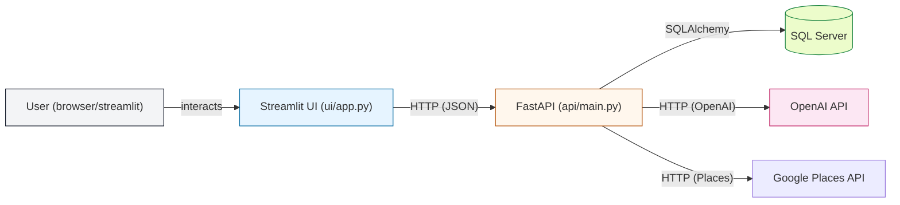
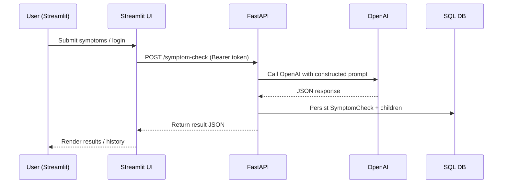

# 🩺 HealthAI Assistant — README

AI-powered symptom analysis with a Streamlit UI, FastAPI backend, SQL Server storage, and GPT-based reasoning.

**What's in this README**
- **Architecture diagram** (Mermaid)
- **User roles & features**
- **API reference** (endpoints, auth, examples)
- **Technical components** and interactions
- **Run & deploy** instructions

**Project layout**
```
.
├── config.py          # Application configuration (DB, API keys)
├── requirements.txt
├── start.bat
├── start.sh
├── api/               # FastAPI backend
│   └── main.py
├── db/                # SQLAlchemy models + DB init
│   └── models.py
└── ui/                # Streamlit frontend
        └── app.py
```

**Architecture**





**User roles & features**

- **End user**: register/login, submit symptom descriptions, view results and history.
- **Admin**: everything end users can do plus: manage users, toggle feature flags, enable/disable functionality.

Active features (admin-controlled via `/features` and admin UI):
- `possible_conditions`: return top possible conditions with probability and severity.
- `home_remedies`: safe home-care suggestions.
- `doctor_recommendations`: specialist recommendations (+nearby doctors if Places API configured).
- `risk_indicator`: Low / Moderate / High urgency indicator.
- `history_tracking`: persist and show past checks.

**API Reference (summary)**

Authentication: OAuth2 password flow with JWT. Obtain token from `/auth/login` using form-data `username` (email) and `password`. Use the returned `access_token` as `Authorization: Bearer <token>` for protected endpoints.

- POST `/auth/register` — Register new user
    - Body: `{ "email": string, "password": string, "full_name": string }`
    - Returns: `{ message, user_id }` (201)

- POST `/auth/login` — Login (OAuth2 form)
    - Form fields: `username` (email), `password`
    - Response (TokenResponse):
        ```json
        {
            "access_token": "<jwt>",
            "token_type": "bearer",
            "is_admin": false,
            "full_name": "...",
            "user_id": 1
        }
        ```

- GET `/features` — List feature flags (public)
    - Response: `[ { "key": "possible_conditions", "label": "...", "enabled": true }, ... ]`

- PATCH `/admin/features/{key}` — Toggle feature (Admin only)
    - Body: `{ "is_enabled": true|false }`

- GET `/admin/users` — List users (Admin only)
- POST `/admin/users` — Create user (Admin only)
- PATCH `/admin/users/{user_id}/toggle` — Enable/disable user (Admin only)

- POST `/symptom-check` — Main AI endpoint (Authenticated)
    - Body example:
        ```json
        {
            "symptoms": "I have a sore throat and mild fever",
            "latitude": 12.9716,
            "longitude": 77.5946,
            "location_name": "Bengaluru"
        }
        ```
    - Behavior: Server constructs a prompt (features determine schema), calls OpenAI, persists a `SymptomCheck` and related `DiagnosedCondition` / `HomeRemedy` / `DoctorRecommendation` rows, and returns:
        ```json
        {
            "check_id": 123,
            "features": ["possible_conditions","home_remedies","risk_indicator"],
            "result": { /* JSON shaped by the enabled features */ },
            "created_at": "2026-06-08T12:34:56.789Z"
        }
        ```

- GET `/history` — List recent checks for current user (Authenticated)
- GET `/history/{check_id}` — Full detail for check (Authenticated)

- GET `/health` — Health check (public)

Notes:
- The server uses `config.API_SECRET_KEY` to sign JWTs and `OAuth2PasswordBearer` for dependency injection.
- GPT call is performed in `api/main.py` via `call_openai()` and expects JSON-only responses.

**Data model (high level)**
- `users`: id, email, password_hash, full_name, is_admin, is_active, created_at
- `feature_flags`: feature_key, label, is_enabled
- `symptom_checks`: user_id, symptoms, raw_result (JSON), risk_level, created_at
- `diagnosed_conditions`, `home_remedies`, `doctor_recommendations` — linked to checks

See schema and init logic in `db/models.py`.

**Technical components**

- Frontend: Streamlit (`ui/app.py`) — user flows, login/register, admin panel, rendering results.
- Backend: FastAPI (`api/main.py`) — REST endpoints, JWT auth, prompt construction, persistence.
- DB: SQL Server (via SQLAlchemy) — models and `init_db()` seed logic in `db/models.py`.
- GPT/LLM: OpenAI API called from backend (`call_openai()`), model configured in `config.py`.
- Optional: Google Places API for nearby doctors.

**Interaction flow (quick)**
1. User signs in/registers via Streamlit UI which calls `/auth/login` or `/auth/register`.
2. User submits symptoms → UI POSTs `/symptom-check` with Bearer token.
3. Backend builds a controlled JSON schema prompt (features decide fields), calls OpenAI.
4. Backend receives JSON-only reply, persists check + associated rows, returns structured result.
5. UI shows conditions, remedies, risk badge, and nearby doctors (if available).

**Run / Dev instructions**

1. Update `config.py` (DB connection string, `OPENAI_API_KEY`, and `API_SECRET_KEY`).
2. Create the SQL Server database `HealthAI` and install ODBC driver if on Windows.
3. Create & activate a Python venv and install deps:

```bash
python -m venv .venv
.venv\\Scripts\\activate   # Windows
# or: source .venv/bin/activate  # mac/linux
pip install -r requirements.txt
```

4. Start the API and UI (two terminals):

```bash
# Terminal 1 — API
uvicorn api.main:app --host 127.0.0.1 --port 8000 --reload

# Terminal 2 — UI
streamlit run ui/app.py --server.port 8501
```

Or use the provided launchers `start.bat` / `start.sh`.

**Useful URLs**
- Streamlit UI: http://localhost:8501
- FastAPI OpenAPI: http://127.0.0.1:8000/docs
- Health: http://127.0.0.1:8000/health

**Credentials & defaults**
- Default seeded admin: `admin@healthai.com` / `Admin@123` (change immediately for production).

**Security & production tips**
- Do not commit secrets. Prefer environment variables or a secret manager.
- Replace `API_SECRET_KEY` with a secure random string.
- Use HTTPS and a reverse proxy for production deployments.
- Limit CORS origins instead of `allow_origins=["*"]` in `api/main.py`.

**Where to look in the codebase**
- API routes and prompt logic: [api/main.py](api/main.py)
- DB models & seeding: [db/models.py](db/models.py)
- Streamlit UI and user flows: [ui/app.py](ui/app.py)
- Configuration: [config.py](config.py)

---

If you want, I can:
- add an OpenAPI example for the `/symptom-check` payload with a curl snippet,
- convert the Mermaid diagrams into PNG and add to repo, or
- create a minimal docker-compose for quick local deployment.

Tell me which of these you'd like next.
